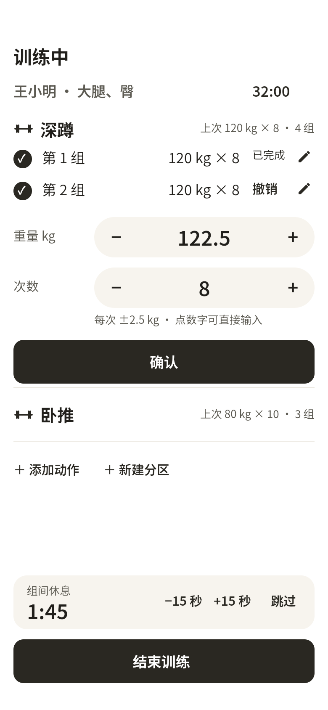
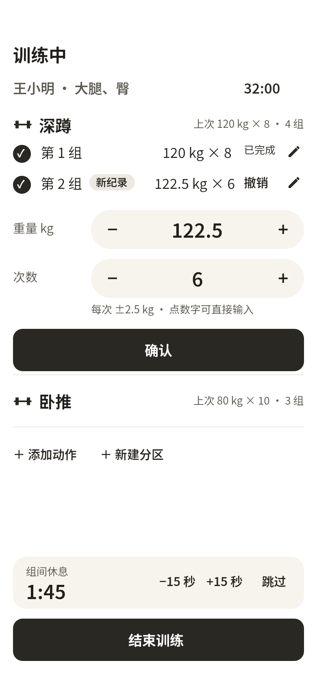
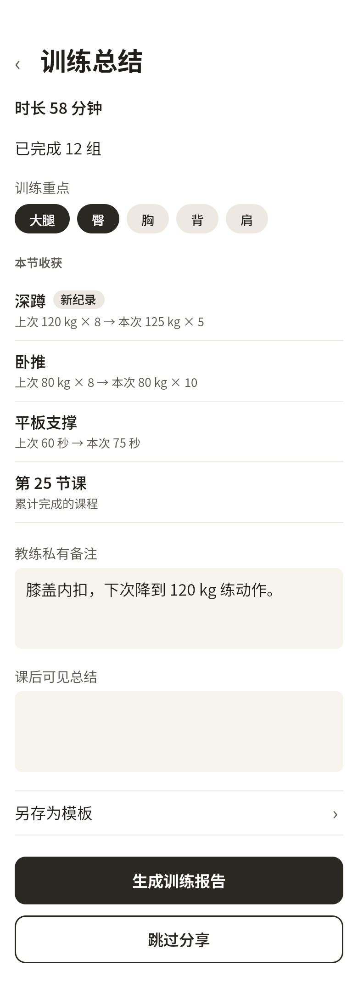
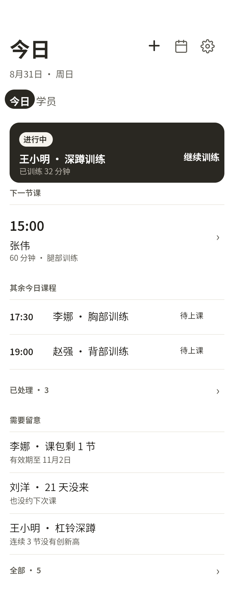
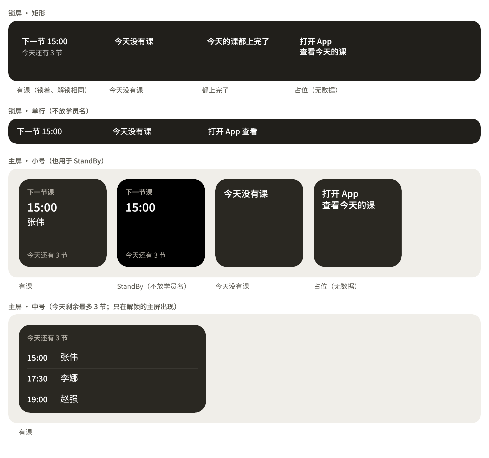
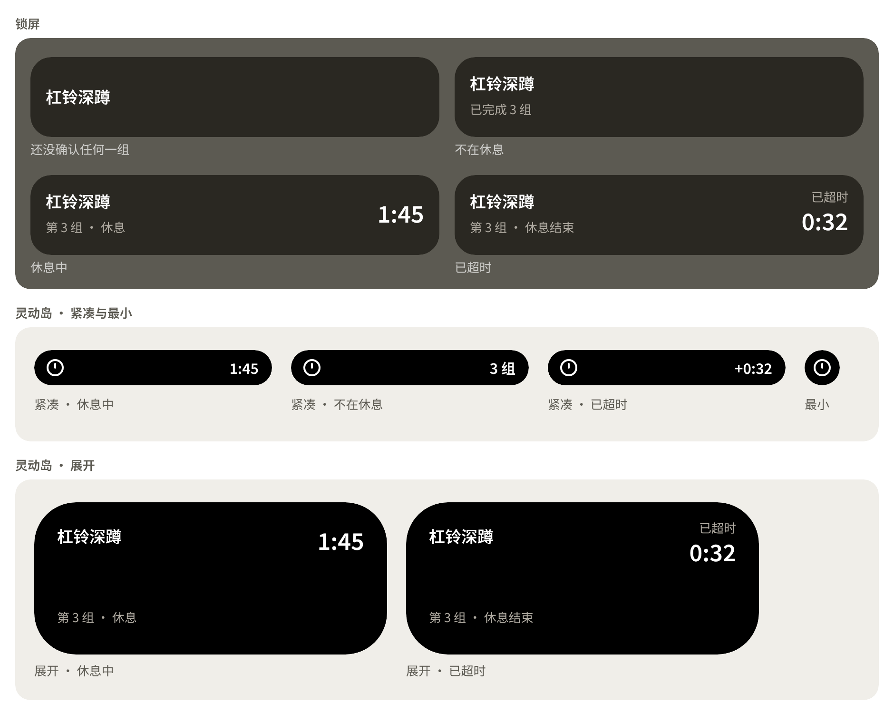
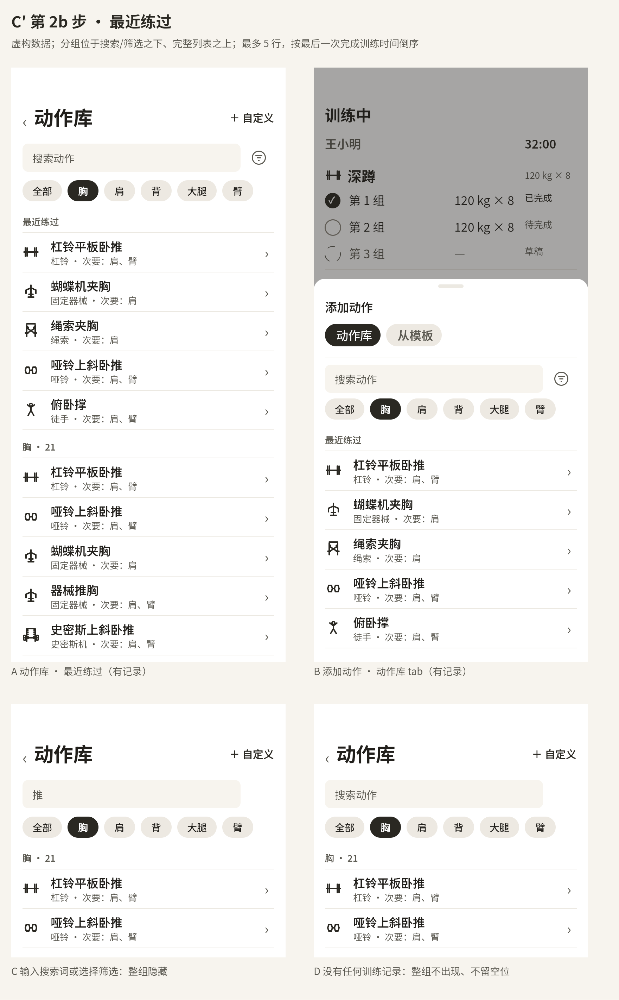
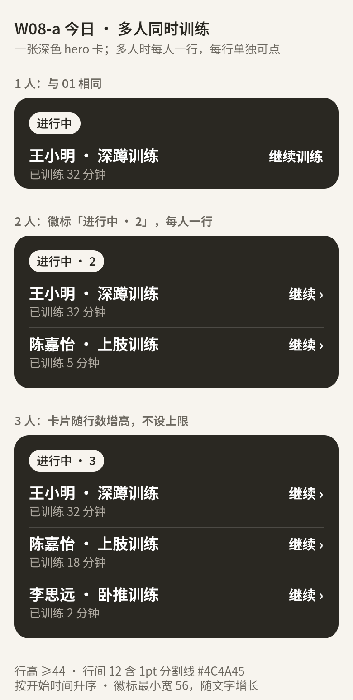

  

<h1 align="center">FineCoach</h1>

精练教练

<a href="README.zh.md">中文</a>

FineCoach is a native iPhone app for personal trainers to schedule classes and record students' training. Records stay on the device, with no account, server, or telemetry. Logging, history, scheduling, and report generation work offline.

## Main features

### Fast set logging

The coach adjusts weight and reps with − / + buttons, or taps the number to type it. When logging an exercise, the coach can also reuse the weight and reps from the same student's last session with that exercise. FineCoach fills in those numbers as a pending set. The set counts as completed only after the coach confirms it.

### Rest timer

When the coach confirms a set, FineCoach automatically starts a 120-second rest countdown. The coach can add or subtract 15 seconds, or skip the rest using the controls at the bottom of the design above. The countdown is not restored after an app restart.

### New-record alerts during training

The coach confirms a set after the student completes it. If the set breaks that student's record for the exercise's main metric, FineCoach labels the set row "New record". The first session with an exercise establishes a baseline and does not count as a new record.

### Session summary: gains and milestones

After a class, the coach can review "Session gains" to compare the same student's previous and current performance for exercises that improved. FineCoach marks new records on those rows. When a student completes their 10th, 25th, 50th, or 100th class (then every 50 classes), FineCoach shows a milestone. When a student trains at least twice a week for consecutive weeks, FineCoach shows "N consecutive weeks" at 4, 8, 12, 26, and 52 weeks (then every 26 weeks).

### "Needs attention" reminders

The coach can review "Needs attention" for stalled progress, course packages running low or nearing expiry, and students who have not trained for at least 14 days and have no future appointment. FineCoach flags packages with two credits or fewer, or within seven days of expiry. For students who have never trained, the 14 days start when their record was created. These are prompts for the coach to review, not diagnoses, and they do not send push notifications.

### Lock screen, widgets and Shortcuts

The coach can check training progress in Live Activity and today's remaining class count and next class time in widgets. FineCoach shows the exercise, completed set count or just-confirmed set number, and rest countdown in Live Activity; the medium home screen widget lists up to three classes. The three Shortcuts—"Today", "Start training", and "Continue training"—require unlocking and only open pages, without creating a session. Student names may appear in home screen widgets, while lock screen displays omit them; see Privacy for the full limits.

### 542 exercises with pinyin search

The coach can search for exercises using Chinese, full pinyin, pinyin initials, or aliases. FineCoach provides 542 built-in exercises with Chinese names, muscle groups, and equipment. The coach can favorite, hide, or copy an exercise into their own list. This version includes no exercise demonstration photos, GIFs, or video.

### Train several students at once

The coach can record several students' training at the same time. FineCoach keeps each student's session separate and shows a "Continue" entry for each on Today. Each student can have at most one session in progress.

## Other features

- **Scheduling and month calendar:** the coach can create single appointments or weekly series ending on a date or after a set number of repeats, edit one occurrence or that occurrence and all later ones, and handle overdue classes by starting, rescheduling, cancelling, or marking an absence.
- **Course packages and credit records:** each student has at most one active package with a balance and end date, a record of charges, returns, and manual corrections, and no block on logging when credits run out or the package expires.
- **Automatic saving and recovery:** meaningful edits are saved automatically, confirmed sets and unfinished drafts return after backgrounding, force-quit, or restart, drafts do not count in statistics, and a failed save keeps an error and retry available while blocking session completion.
- **Training history and exercise trends:** the coach can filter history by date, training focus, and exercise, compare the same student's records with a compatible focus, and review compatible weight, reps, duration, and volume trends, with reduced assistance treated separately from added load; some barbell exercises offer an estimated one-rep max (1RM) trend from completed sets with positive weight and 1–10 whole-number reps, which is an estimate rather than a measured maximum.
- **Body data:** recording is optional, with built-in height, weight, body fat, and common girths plus custom measures, one entry per measure per day, and unit changes that affect display without changing stored values.
- **Share cards:** the coach can generate a read-only image from a completed session, review the final preview, and use the system share sheet, with sensitive fields excluded as listed under Privacy.
- **Read-only student archive:** the coach selects and previews content for one student's encrypted snapshot, which the student view can browse offline with search and filters, without editing, adding sessions, or generating share cards.
- **Encrypted backup and restore:** the coach initiates a full backup with a password the app does not remember, and restore replaces current data only after password, integrity, and compatibility checks pass, preserving it if the password is wrong or the file is damaged or incompatible.
- **Training templates:** the coach can reuse exercises and planned sets, with an independent snapshot kept in the session after applying a template, and organize exercises into sections.

## Privacy

- Records stay on the device; there is no account, server, or telemetry.
- Appointment reminders go only to the coach and contain generic wording and a time, without student names.
- Rest notifications can include the exercise name.
- Live Activity does not show student names, weight, or reps.
- Lock screen widgets omit student names; home screen widgets may show them.
- Share cards never include sex, body data, injuries, private notes, phone numbers, or WeChat IDs, and no option enables those fields; each card starts with minimal disclosure and does not reuse the previous card's temporary options.
- Student archives never include injuries, private notes, course packages, appointments, or contact details; body data can be included if the coach selects it for export.
- Share-card and archive filenames omit student identity; archive passwords must be at least 8 characters and are not stored, uploaded, or recoverable by the app.
- A cancelled or failed share is not recorded as sent; the app cannot edit or recall an image after it has left through the system share sheet.

## Version scope

- Simplified Chinese, iPhone portrait, light interface.
- iOS 18 and later, built with native Swift and SwiftUI and on-device Core Data.
- One coach, one phone, with independent sessions for multiple students in progress at the same time; each coach in a small studio uses their own phone.
- Coach use and the read-only student view are mutually exclusive choices per installation, with no direct switch afterwards; archive import is blocked while coach records are on the phone.
- Android, iPad, Apple Watch, dark mode, group classes, payments, cloud sync, and in-app booking or chat are outside this version.

## Build

Open `ios/FineCoach.xcodeproj` in Xcode and select the `FineCoach` scheme. The project uses Apple frameworks only.

Simulator results and physical-device results are separate evidence. The acceptance record and known gaps are in `ios/VALIDATION.md`.

## License

[MIT](LICENSE). Copyright (c) 2026 Ignacio Li.

The exercise library draws from free-exercise-db (Unlicense), [wger](https://wger.de) (CC-BY-SA 3.0/4.0 and CC0), and FineCoach originals (MIT). Per-exercise sources and licenses are recorded in [`provenance.json`](ios/FineCoachApp/Resources/ExerciseCatalog/provenance.json). When an archive includes built-in exercises, the student view shows their attribution. Each entry retains its source license; the repository's MIT license does not replace those licenses.
