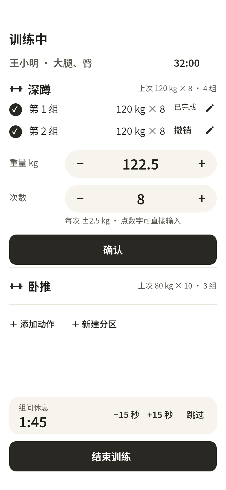
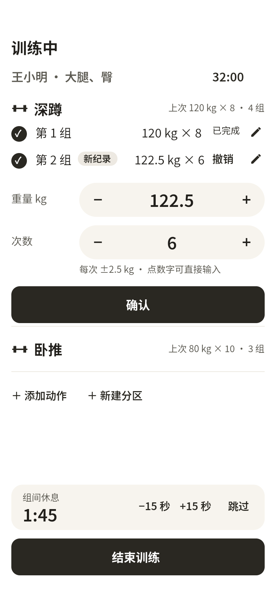
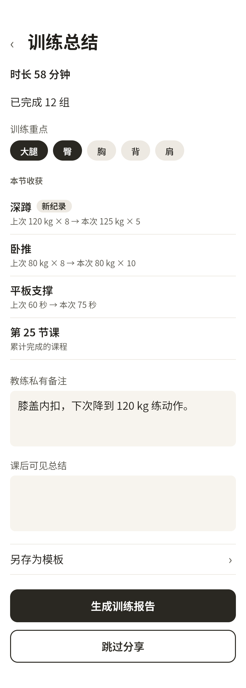
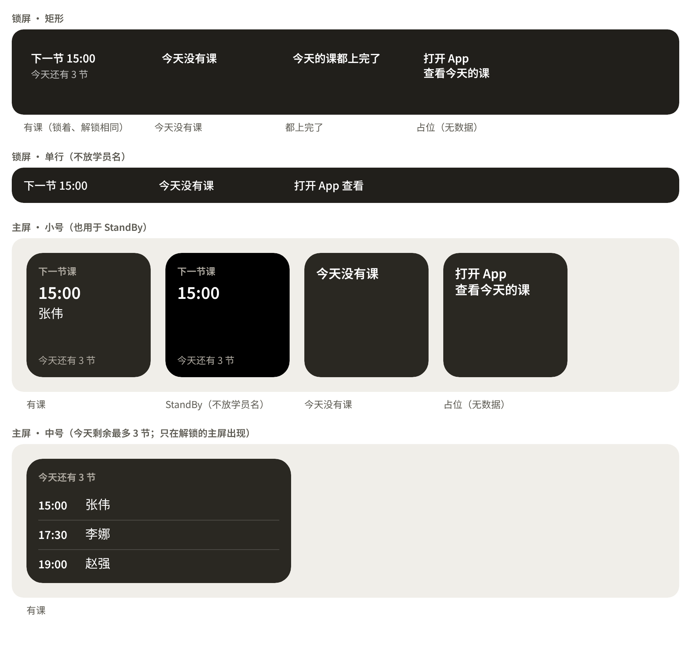
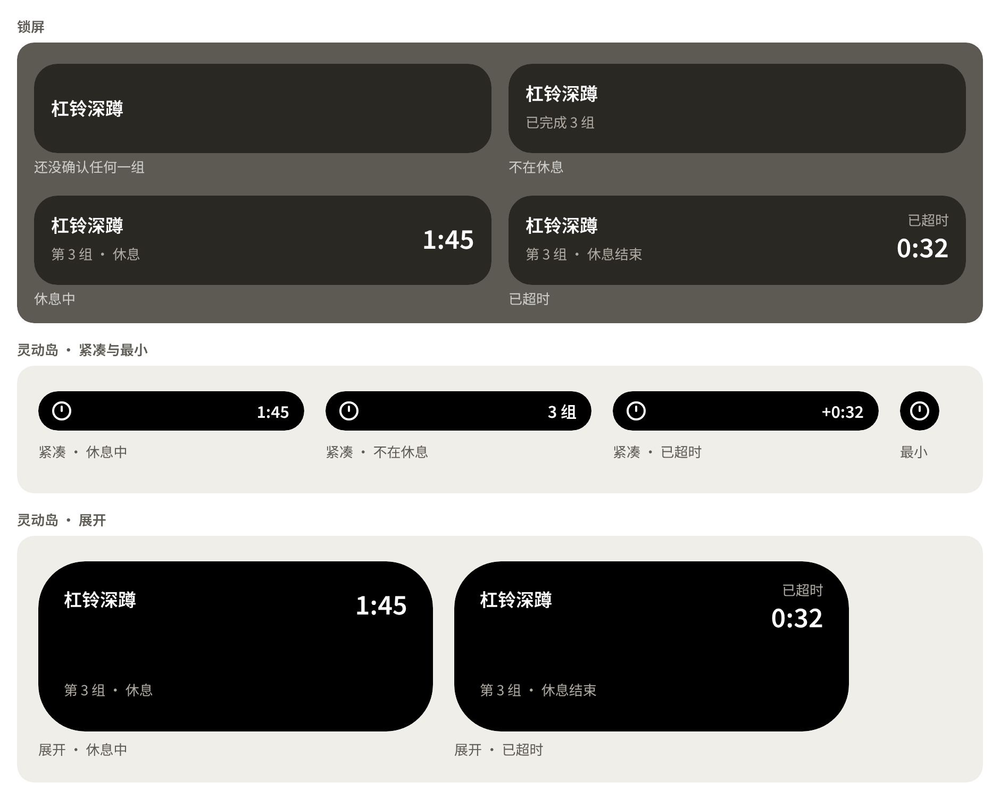
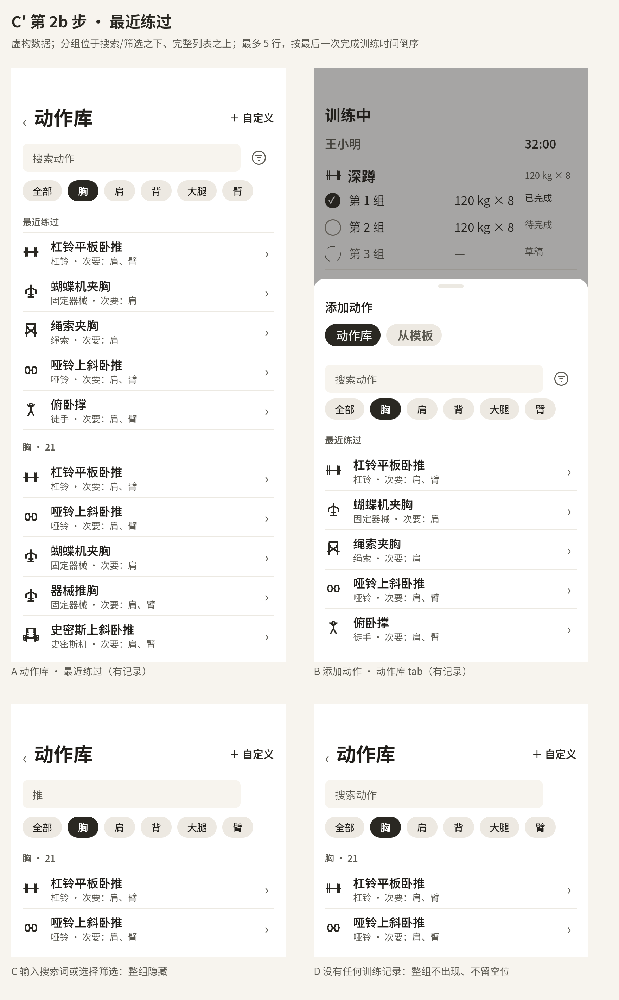
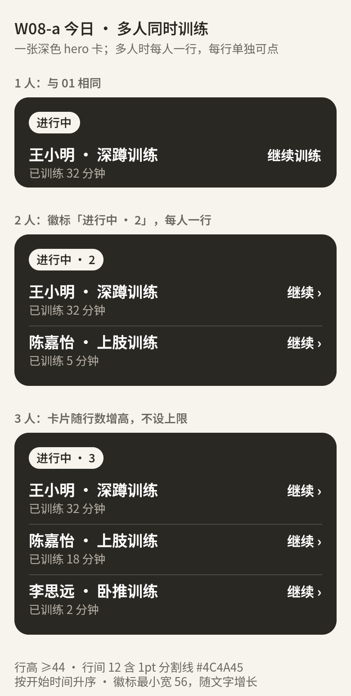

  

<h1 align="center">精练教练</h1>

FineCoach

<a href="README.md">English</a>

精练教练是一款原生 iPhone App，供私人教练排课、记录学员训练。数据只保存在本机，没有账号、服务器和遥测。记课、查历史、排课和生成报告都可以离线完成。

## 主要功能

### 高效记录训练

教练用 − / + 按钮调整重量和次数，也可以点数字直接输入。记录动作时，教练还可以带入同一名学员上次做这个动作的重量和次数。App 将这些数字填入待完成的组。教练确认后，这一组才计入完成组。

### 组间休息计时

教练确认一组后，App 自动开始 120 秒休息倒计时。教练可以加减 15 秒，也可以跳过休息，操作入口见上图底部。App 重启后不会恢复这次倒计时。

### 训练中提示破纪录

学员完成一组后，由教练确认记录。如果这一组刷新了该学员在这个动作上的主指标纪录，App 会在组行显示「新纪录」。第一次做这个动作只建立基线，不算破纪录。

### 本节收获与里程碑

下课后，教练可以在「本节收获」中查看有进步的动作，对比同一名学员上次和本次的表现。App 会在对应行标出新纪录。学员累计完成第 10、25、50、100 节课时（之后每 50 节一次），App 显示里程碑。学员连续多周、每周至少完成 2 节课时，App 在第 4、8、12、26、52 周（之后每 26 周一次）显示「连续 N 周」。

### 「需要留意」提示

教练可以在「需要留意」中查看三类情况：进步停滞、课包快用完或快到期，以及至少 14 天没练且没有未来预约的学员。课包余量不超过 2 节或将在 7 天内到期时，App 会提示教练。从未训练过的学员，14 天从建立学员记录时起算。这些提示供教练查看，不是诊断，也不发推送通知。

### 锁屏、小组件和快捷指令

教练可以通过实时活动（Live Activity）查看训练进度，通过小组件查看今天剩余课数和下一节时间。App 在 Live Activity 中显示动作、已完成组数或刚确认的组序号，以及休息倒计时；主屏中号小组件最多列出 3 节课。「今日」「开始训练」「继续训练」三个快捷指令都需要先解锁，只跳转页面，不会创建训练。主屏小组件可能显示学员姓名，锁屏不显示，具体范围见「隐私」。

### 542 条动作，支持拼音搜索

教练可以用中文、拼音全拼、首字母或动作别名搜索动作。App 内置 542 条动作，提供中文名称、肌群和器材信息。教练可以收藏、隐藏动作，也可以复制成自己的动作。这一版不含动作演示照片、GIF 或视频。

### 多名学员同时上课

教练可以同时记录多名学员的训练。App 为每名学员独立记录，并在「今日」逐人显示「继续」入口。每名学员最多只能有一节进行中的训练。

## 其他功能

- **排课和月历**：教练可以安排单次课程或按日期、次数结束的每周重复课程，修改单次或本次及之后的安排，并对逾期课程选择开始、改期、取消或标记缺席。
- **课包和扣次记录**：每名学员最多有一个有效课包，记录剩余课时、有效期及扣减、返还和人工修正，课包用完或过期不影响记课。
- **自动保存和恢复**：有效修改会自动保存，切后台、强制退出或重启后可恢复已确认的组和未确认的草稿，草稿不进入统计，保存失败时保留错误和重试入口，并阻止完成训练。
- **训练历史和动作趋势**：教练可以按日期、训练重点和动作筛选历史，对比同一学员、训练重点兼容的记录，查看重量、次数、时长和容量趋势，辅助器械减配重与普通加重分开处理；部分杠铃动作提供估算一次最大重量（1RM）趋势，由正重量、1～10 次整数次数的完成组推算，是估算值，不是实测最大重量。
- **身体数据**：教练可以选择不记录，或记录内置的身高、体重、体脂、常见围度及自定义指标，同一指标一天一条，切换单位只改变显示，不改写存储值。
- **分享卡**：教练可以从一节已完成的训练生成只读图片，确认最终预览后通过系统分享，排除的敏感字段见「隐私」。
- **学员只读档案**：教练逐项选择并预览内容，为一名学员导出加密快照，学员视图可离线浏览、搜索和筛选，但不能编辑、新建训练或生成分享卡。
- **加密备份和恢复**：教练主动导出完整备份并设置 App 不会记住的密码，恢复时先检查密码、完整性和兼容性，通过后才替换当前数据，密码错误、文件损坏或版本不兼容时保留原数据。
- **训练模板**：教练可以复用动作和计划组，应用后在本节训练中保留独立快照，也可以用分区组织动作。

## 隐私

- 数据只保存在本机，没有账号、服务器和遥测。
- 预约提醒只发给教练，内容是通用提醒和时间，不含学员姓名。
- 休息通知可以带动作名。
- Live Activity 不显示学员姓名、重量和次数。
- 锁屏小组件不显示学员姓名，主屏小组件可能显示。
- 分享卡永远不含性别、身体数据、伤病、私人备注、电话和微信，也没有打开这些字段的选项；每次从最少披露开始，不沿用上次临时打开的选项。
- 学员档案永远不含伤病、私人备注、课包、课程安排和联系方式；教练选择导出时，可以包含身体数据。
- 分享卡和档案的文件名不含学员身份；档案密码至少 8 个字符，App 不保存、不上传，也无法找回。
- 取消或失败的分享不会记为已发送；图片通过系统分享交出去后，App 无法修改或撤回。

## 版本边界

- 简体中文，iPhone 竖屏，浅色界面。
- iOS 18 及以上，使用原生 Swift / SwiftUI 和本机 Core Data。
- 一位教练，一台手机，可同时保留多名学员各自进行中的训练；小型工作室的每位教练使用自己的手机。
- 同一次安装在教练视图和学员只读视图中二选一，之后不能直接切换；手机上已有教练记录时，不能导入学员档案。
- 不包含 Android、iPad、Apple Watch、深色模式、团课、付款、云同步，以及学员在 App 里预约或聊天。

## 构建

用 Xcode 打开 `ios/FineCoach.xcodeproj`，选择 scheme `FineCoach`。工程只使用 Apple 框架。

模拟器结果和真机结果分别记录。验收记录和已知缺口在 `ios/VALIDATION.md`。

## 许可

[MIT](LICENSE)。Copyright (c) 2026 Ignacio Li。

动作库来源包括 free-exercise-db（Unlicense）、[wger](https://wger.de)（CC-BY-SA 3.0/4.0 和 CC0），以及 FineCoach 自建（MIT）。逐条来源和许可记录在 [`provenance.json`](ios/FineCoachApp/Resources/ExerciseCatalog/provenance.json)。档案包含内置动作时，学员视图会显示署名。各条动作沿用其来源许可，本仓库的 MIT 许可不替代这些许可。
