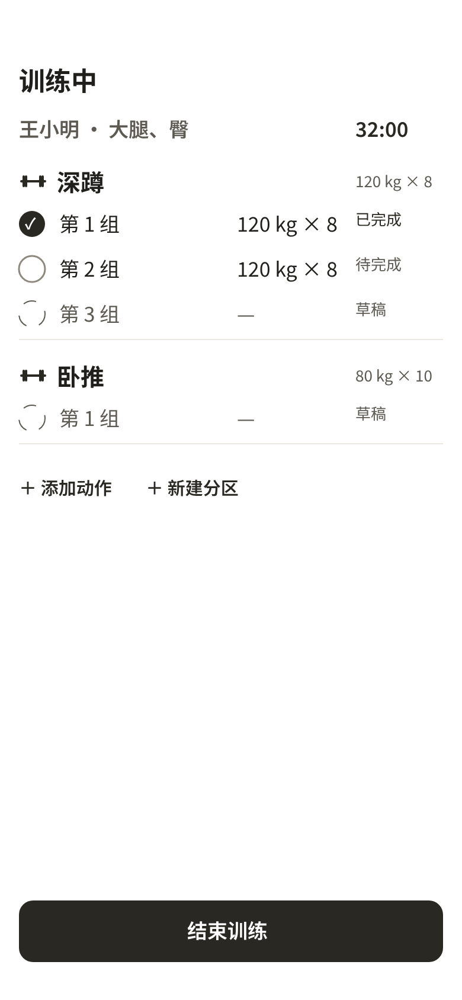
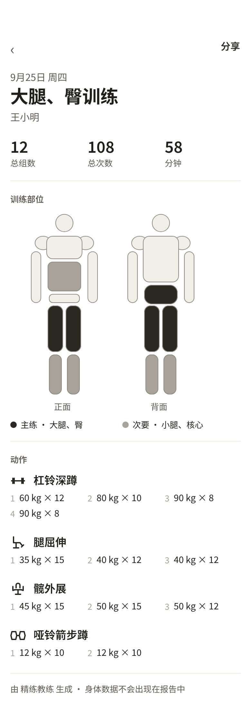
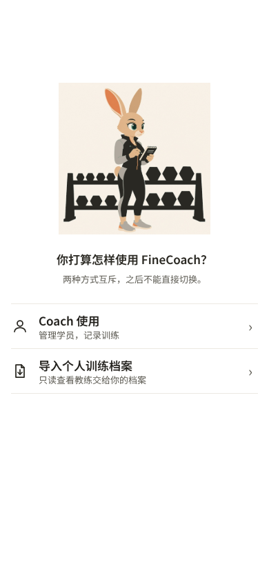
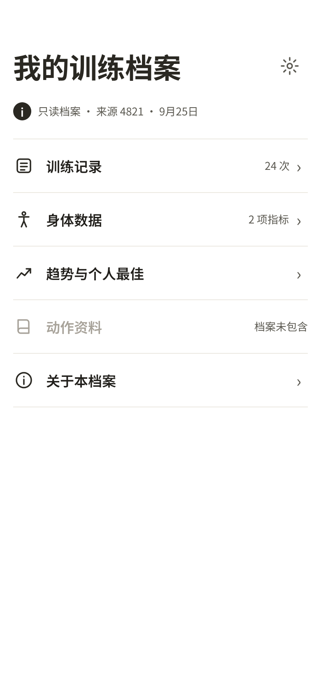

  

<h1 align="center">精练教练</h1>

FineCoach

给私人教练的本地课堂记录。 数据留在这台 iPhone 上。

<a href="README.md">English</a>

精练教练是一款原生 iPhone 应用，服务一对一健身课。同一款 App 有两个视图。教练视图用来排课、记组、看进展，并把一张训练报告或一份加密档案交出去。学员视图只读打开那份档案。没有账号，没有服务器，没有遥测。飞行模式下，记课、查历史、排课和生成报告都能完成。

---

## 课堂上，一组休息就够记完

训练进行中，教练按实际完成的情况记重量、次数、时长，需要时分开左右侧，也有专门的有氧记录。从上一组或上次同一动作带过来的数字先停在「待完成」，教练改过或确认之后才算数。空训练不能被存成一条完成记录。

同一时间只有一节进行中的训练。动作可以来自内置库、教练自己的动作，或「仅本次」。仅本次的动作留在这节课里，不会进入动作库。

  

## 已确认的组，关掉 App 也还在

每一次有效修改都会自动写下。切到后台、强制退出或重启之后，已确认的组和还没确认的草稿都会回来。草稿仍然不进入统计。保存失败时界面保持错误状态和重试入口，不会显示「已保存」，也不能把这节课标成完成。

## 今天的课，和真正上过的课，是两件事

「今日」把进行中的训练、逾期待处理的课、下一节和今天其余的安排放在一起。月历用来看某一天。课程可以是单次，也可以是每周固定几天、按日期或次数结束的周期。改一节课时，可以选择只改这一次，或从这次起改以后的。

到点没处理的课会一直停在「逾期待处理」，直到教练开始、改期、取消或标成缺席。提醒只发给教练，锁屏上只有通用的训练提醒和时间，不出现学员姓名。

## 课时有账，钱不进这款 App

一名学员同时只有一个有效课包。课包记录剩余课时和有效期。完成一节关联的课最多扣一次。取消不扣。缺席由教练决定扣不扣。临时训练在结束时由教练选择。过期或课时不够，不会拦住记课，也不会自动变成负数。

每一次扣减、返还和人工修正都留下一条可追溯的记录。重新打开已扣课的训练会把那一次扣减还回去。重复完成或重复编辑不会再扣一次，也不会再还一次。

## 进展用同一把尺子量

历史可以按日期、训练重点和动作筛选。同一名学员、训练重点对得上的记录才能放在一起比。动作趋势按兼容的口径显示重量、次数、时长和容量。辅助器械上配重下降算进步，不跟普通加重混成一张榜。个人最佳只认说得清的规则，例如最高重量、同一重量下的最多次数、最长时长。这里没有估算 1RM，也没有一个总分代替判断。

身体数据可以完全不记。身高、体重、体脂和常见围度是内置指标，教练也可以加自己的指标。同一指标一天一条。切换公斤和磅只改变显示，不改写已经记下的数。

## 交给学员的，先给教练看一遍

训练报告是一张只读图片，由教练从某一次已完成的训练主动生成。生成前有最终预览。每次都从最少披露开始，上次临时打开的选项不会自动沿用。

性别、身体数据、伤病、私人备注、电话和微信永远不会进入报告，界面上没有打开它们的开关。文件名不含学员身份。交付走系统分享。取消或失败不会被记成「已经发出」。已经交到系统外面的图片，这款 App 改不了，也不假装能撤回。

  

## 教练视图，和学员的只读视图

第一次打开会问：「你打算怎样使用精练教练？」两个入口互斥，屏幕上写着：之后不能直接切换。

**Coach 使用**进入教练视图，副标题是「管理学员，记录训练」。排课、记组、历史、课包、报告和档案导出都在这里。

**导入个人训练档案**进入学员视图，副标题是「只读查看教练交给你的档案」。这里只能打开教练交来的那一份加密快照。

选定并开始使用之后，这次安装停在当前视图里。App 没有在两个视图之间来回切换的入口。这台手机上已经有教练记录时，导入会被拦住，两套数据不会混在一起。学员视图里也不能记教练的课。

  

教练在教练视图里为一名学员导出档案：某一时刻的完整快照，不是持续同步。导出前能逐项取舍，并看到将要带上的正文。伤病、私人备注、课包、课程安排和联系方式永远不在档案里。密码至少 8 个字符，App 不保存、不上传、也找不回。文件名不写学员姓名。

学员视图离线浏览训练记录、已包含的身体数据、趋势和动作资料。可以搜索和筛选，可以改这台手机上的显示单位。不能编辑，不能加训练，不能再生成报告。更新时只接受同一来源、同一学员的较新完整快照，整份替换，不逐条合并。换不进去的时候，旧档案保持完整。

  

## 备份是教练自己发起的

完整备份由教练导出，并设置一个 App 不会记住的密码。恢复前先检查密码、完整性和兼容性，通过之后才整份替换当前数据。密码错误、文件损坏或版本不合时，这台手机上的数据保持原样。

## 动作库写得出处

内置库有 146 个动作，来自 [wger](https://wger.de)，按 CC-BY-SA 使用，并在档案的动作资料里署名。每个动作有中文名称、肌群和器材。教练可以收藏、隐藏，或复制成自己的动作。这一版不带动作图片、GIF 或视频。

---

## 这一版的边界

- 简体中文，iPhone 竖屏，浅色界面。
- iOS 18 及以上。实现是原生 Swift / SwiftUI，数据在本机的 Core Data 里。
- 一位教练，一台手机，一对一。小型工作室按「每人自己的手机」使用。教练视图和学员只读视图在同一次安装里二选一，之后不能直接切换。
- 不包含 Android、iPad、Apple Watch、深色模式、团课、付款、云同步，以及学员在 App 里预约或聊天。

## 构建

用 Xcode 打开 `ios/FineCoach.xcodeproj`，选择 scheme `FineCoach`。工程只使用 Apple 框架。

模拟器上的结果和真机上的结果是两件事。验收记录和已知缺口在 `ios/VALIDATION.md`。

## 许可

[MIT](LICENSE)。Copyright (c) 2026 Ignacio Li。

内置动作资料的许可见上文，不由本仓库的 MIT 许可覆盖。
